
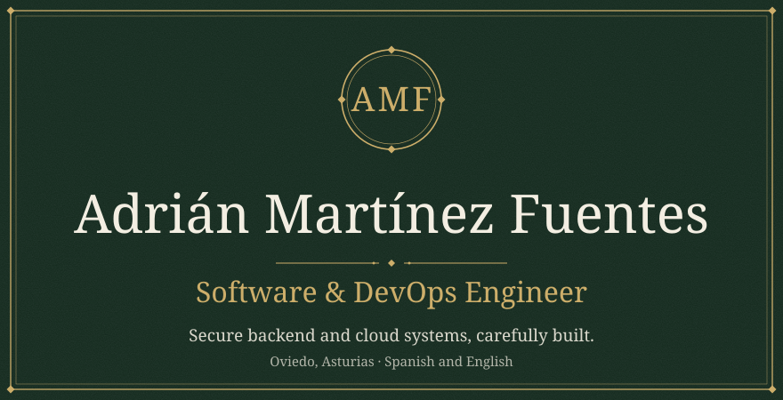

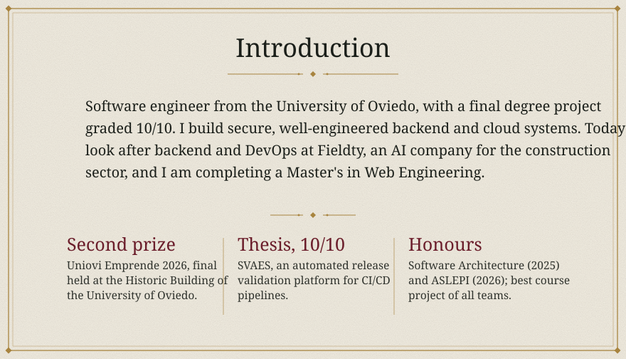

<a href="https://github.com/adrianmfuentes/SVAES">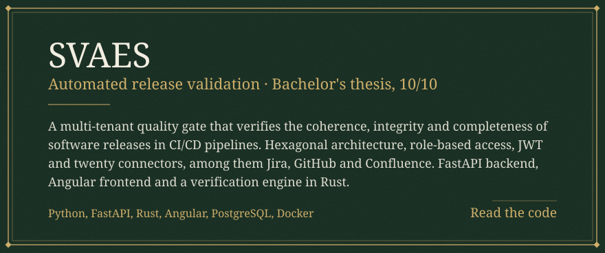</a>

<a href="https://fieldty.es/">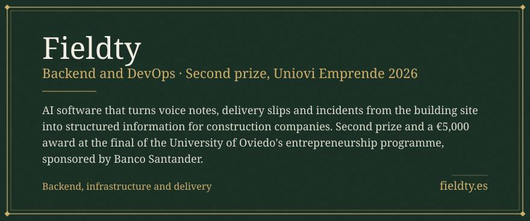</a>

<a href="https://github.com/adrianmfuentes/nutritionai">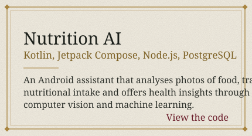</a>
<a href="https://github.com/Arquisoft/wichat_en2b">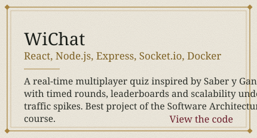</a>

<a href="https://github.com/adrianmfuentes/DLP">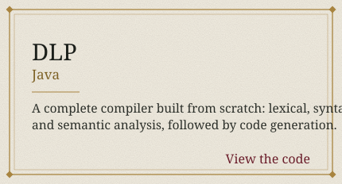</a>
<a href="https://github.com/adrianmfuentes/SGDB">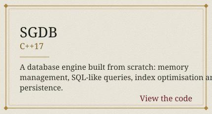</a>

<a href="https://github.com/adrianmfuentes/HTTP-server">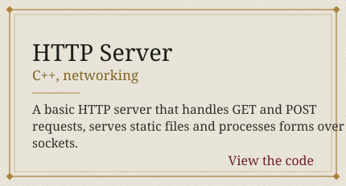</a>
<a href="https://github.com/adrianmfuentes/url-shortener">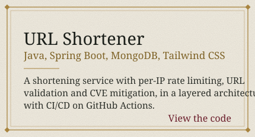</a>

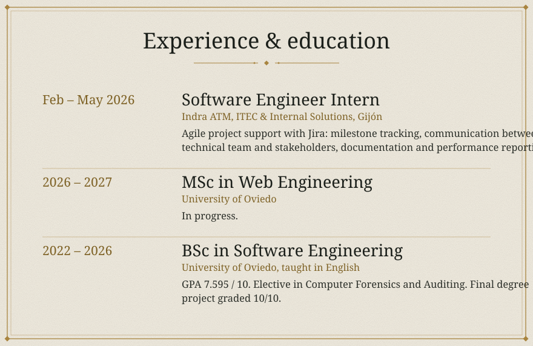

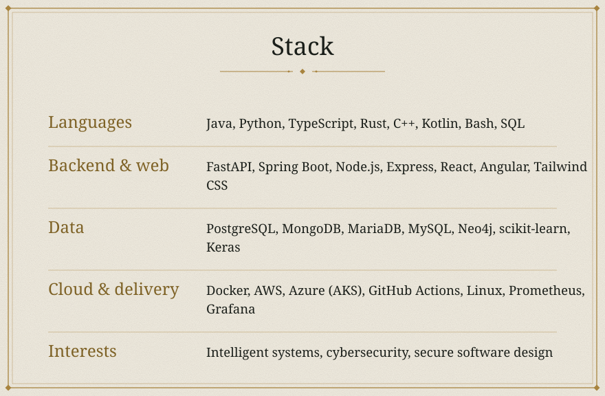

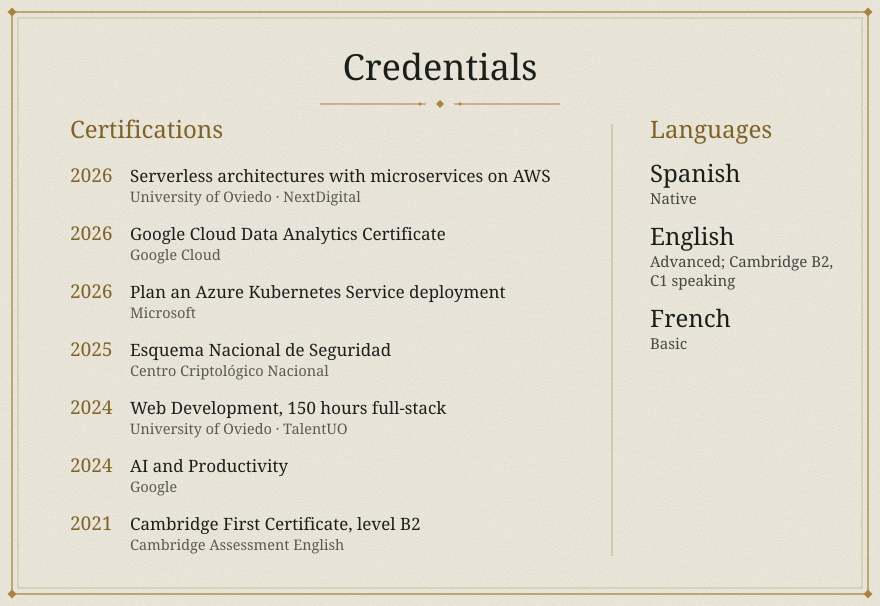

<a href="https://adrianmf.dev">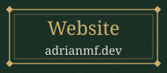</a>
<a href="https://cv.adrianmf.dev">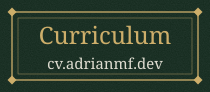</a>
<a href="https://linkedin.com/in/martinezfuentesadrian-dev">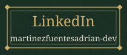</a>
<a href="mailto:contact@adrianmf.dev">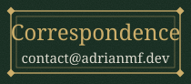</a>

